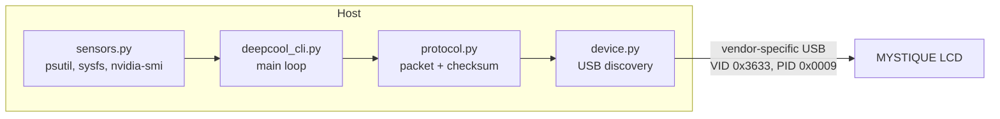

# DeepCool Display Controller

A headless Linux daemon that drives the LCD of the DeepCool MYSTIQUE 240/360 AIO cooler. It is a Python port of [qt-deepcool](https://github.com/mymymy1303/qt-deepcool) for servers without a display.


> [!WARNING]
> This port has not yet run against a physical cooler. Packet construction, the checksum, byte offsets and the full startup → init → update → shutdown sequence were tested against a simulated device. USB communication with real hardware was not. If the screen does not update or shows garbled values, report it as a bug.

## Overview

The daemon reads CPU and GPU temperature and usage, plus RAM usage, from the host. It encodes them into a 48-byte packet and sends it to the cooler's 2.8" LCD over USB at a fixed interval. It needs no desktop environment, no network port and no root privileges at runtime.

## How it works



1. `device.py` finds the cooler on the USB bus and claims its vendor interface.
2. The cold-boot initialization sequence runs. Without it, the cooler keeps its boot logo and ignores display data.
3. The loop reads sensors, builds the display packet, sends it and sleeps for the configured interval.

## Tech stack

| Component | Tool |
|---|---|
| USB communication | [`pyusb`](https://github.com/pyusb/pyusb) on `libusb-1.0` |
| CPU, RAM and temperature sensors | [`psutil`](https://psutil.readthedocs.io) |
| GPU metrics | `nvidia-smi` (CSV output); AMD via sysfs `gpu_busy_percent`, untested |
| Service management | systemd |
| Device permissions | udev rule scoped to the cooler's VID/PID |

## Requirements

- Linux (developed on Ubuntu 24.04)
- Python 3.10+
- `libusb-1.0` at system level: `sudo apt install libusb-1.0-0`
- A DeepCool MYSTIQUE 240 or 360 connected over USB

## Installation

```bash
sudo git clone https://github.com/cassianorcarneiro/deepcool-display-controller.git /opt/deepcool-display-controller
cd /opt/deepcool-display-controller
sudo python3 -m venv venv
sudo venv/bin/pip install -r requirements.txt
```

Install the udev rule. It grants the `plugdev` group access to the cooler, so neither the service nor manual runs need root.

```bash
sudo cp 99-deepcool.rules /etc/udev/rules.d/
sudo udevadm control --reload-rules
sudo udevadm trigger
```

Create the unprivileged service account:

```bash
sudo useradd --system --shell /usr/sbin/nologin --groups plugdev deepcool
```

## Usage

For manual runs, your own user must be in `plugdev`:

```bash
sudo usermod -aG plugdev "$USER"   # log out and back in afterwards
```

```bash
# List detected devices
venv/bin/python deepcool_cli.py --list

# Run in CPU mode, logging every update
venv/bin/python deepcool_cli.py --mode cpu --interval 1000 --verbose
```

> [!NOTE]
> Call the venv interpreter directly. `sudo python3 deepcool_cli.py` runs the system interpreter, which does not have `pyusb`. If you need root for debugging, use `sudo venv/bin/python`.

### Run as a systemd service

```bash
sudo cp deepcool-cli.service /etc/systemd/system/
sudo systemctl daemon-reload
sudo systemctl enable --now deepcool-cli

systemctl status deepcool-cli
journalctl -u deepcool-cli -f
```

To change options for the service, edit `ExecStart` in the unit file, then run `sudo systemctl daemon-reload && sudo systemctl restart deepcool-cli`.

## Configuration

All configuration is done through command-line flags.

| Option | Default | Description |
|---|---|---|
| `-l, --list` | | List detected devices and exit |
| `-d, --device <path>` | `0` | Device path or index |
| `-i, --interval <ms>` | `1000` | Update interval, clamped to 100–10000 ms |
| `-m, --mode <mode>` | `cpu` | Display mode: `cpu`, `gpu`, `gpu_focus` |
| `-r, --rotate <deg>` | `0` | Screen rotation: `0`, `90`, `180`, `270` |
| `-f, --fahrenheit` | off | Show Fahrenheit instead of Celsius |
| `-V, --verbose` | off | Log the readings of every update |
| `-D, --daemon` | off | Fork to background; unnecessary under systemd |

## Porting notes

This is a from-scratch Python rewrite, not a wrapper around the C++ binary. Every packet offset and the checksum algorithm were transcribed from the C++ source. They were then checked against independent reference calculations; see the tests referenced in the `protocol.py` docstring.

Dropping Qt removes two costs of the original:

- The Qt6 build toolchain, the heaviest part of its dependency chain.
- The `QT_QPA_PLATFORM=offscreen` workaround its systemd unit needed on a headless host.

What was not carried over:

- **The GUI.** This project is CLI-only.
- **The GUI's sensor functions.** Three of them (`getCPUUsage`, `getGPUTemperature`, `getGPUUsage`) were placeholders in the original, such as `return 45.5f;`. They were never on the working CLI path. This port follows the complete implementations in `main_cli.cpp`.

One documentation fix: the original `PROTOCOL.md` described bytes 24–25 as an "MHz value". Its worked example did not match what the C++ code computes there. The description now matches the real formula; see the note in `PROTOCOL.md`.

## Why this is not containerized

My other self-hosted services run in Docker. This one runs as a native systemd service on purpose.

- **The program's job is to cross the isolation boundary.** It holds an exclusive handle on one USB device and detaches the kernel driver from its interface. A container would need device passthrough to do that, which removes most of the isolation benefit.
- **It reads host sensors.** `/sys`, `/proc` and `nvidia-smi` would all need to be mounted or passed through.
- **Least privilege is already achievable natively.** The service runs as an unprivileged user. The udev rule grants access to one VID/PID pair and nothing else.

## Limitations

- **Only NVIDIA GPU metrics are verified.** The AMD path comes from the original and has not run on AMD hardware.
- **No Intel iGPU support.** The original's stub passed a literal glob string as a file path and never worked. It was dropped rather than kept as dead code.
- **No HID implementation.** The MYSTIQUE exposes a vendor-specific interface, not standard HID. See the `protocol.py` module docstring.
- **Cold-boot initialization on every start.** After a power cycle, the cooler ignores display data until initialized. The daemon runs the sequence automatically.

## Project structure

```
deepcool-display-controller/
├── deepcool_cli.py        # Entry point: CLI parsing, main loop
├── device.py              # USB device discovery
├── protocol.py            # Packet format, checksum, display commands
├── sensors.py             # CPU/GPU temperature and usage, RAM usage
├── 99-deepcool.rules      # udev rule for non-root access
├── deepcool-cli.service   # systemd unit
├── PROTOCOL.md            # USB protocol documentation
├── requirements.txt
├── LICENSE
└── README.md
```

## Roadmap

- [ ] Validate against real hardware and fix what the first run finds
- [ ] Test the AMD GPU path on real hardware
- [ ] Config file, if CLI flags stop being enough

## License

Released under the [MIT License](LICENSE). Derived from [mymymy1303/qt-deepcool](https://github.com/mymymy1303/qt-deepcool) (MIT), which was inspired by [Qt-deepcool-digital](https://gitlab.com/public_projects5782906/Qt-deepcool-digital).

## Author

**Cassiano Ribeiro Carneiro** · [@cassianorcarneiro](https://github.com/cassianorcarneiro)

## AI assistance

The C++-to-Python port, the protocol verification and the documentation were developed with Claude (Anthropic). The author defined the project direction and requirements.
